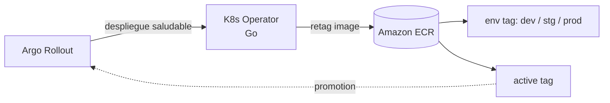

[English](README.md) · [Español](README.es.md)

Conecto el desarrollo con las operaciones construyendo automatización robusta y plataformas cloud-native. Experto en orquestación de infraestructura y en crear herramientas a medida para desarrolladores en entornos de alta escala.

## 🌱 Actualmente

- 🔭 Construyendo operadores de Kubernetes y componentes de IDP en **Go**
- ⚙️ Publicando extensiones de Azure DevOps en **TypeScript**
- 💬 Pregúntame sobre: **Terraform, Kubernetes, GitOps, Azure DevOps, multi-cloud**

## 🛠 Stack Tecnológico

**Cloud y Orquestación**

 

**Programación y Automatización**

- **IaC:** Terraform, Terragrunt, Pulumi, Crossplane
- **CI/CD & GitOps:** Azure DevOps, GitHub Actions, Jenkins, Argo (CD, Rollouts, Workflows)
- **Containers:** Kubernetes, OpenShift, Docker, Helm

## 🏅 Certificaciones

[-0078D4?style=for-the-badge&logo=microsoftazure&logoColor=white)](https://www.credly.com/badges/15d5f031-733c-4d28-b9e2-76bac2120c9e)

## 📂 Proyectos Destacados

### 🛠 Ecosistema de Extensiones para Azure DevOps
Extensiones propias usadas por varias organizaciones para agilizar procesos DevOps:

| Extensión | Qué hace |
|---|---|
| [**SonarCloud Automator**](https://github.com/henryd24/azdevops-sonarcloud-create-project) | Provisión sin intervención: verifica si el proyecto existe en SonarCloud y lo crea si no. |
| [**SonarQube Automator**](https://github.com/henryd24/azdevops-sonarqube-create-project) | Mismo flujo para SonarQube autoalojado. |
| [**Pipeline Execution Manager**](https://github.com/henryd24/azdevops-extension-exec-pipeline) | Ejecuta pipelines, espera su fin y verifica éxito, fallo o cancelación en dependencias complejas. |
| [**azure_devops_cli**](https://github.com/henryd24/azure_devops_cli) | CLI no oficial de Azure DevOps escrita en Go. |

### ⚓ Desarrollo Cloud-Native
[**kubernetes-operator-tag-images**](https://github.com/henryd24/kubernetes-operator-tag-images) es un operador en Go que observa Argo Rollouts y, cuando un despliegue está saludable, retaguea la imagen en Amazon ECR con tags por entorno y un tag activo para facilitar promoción y trazabilidad.

## 🧠 Filosofía
> "No te limites a gestionar infraestructura; construye las herramientas que la gestionen por ti."
> Me enfoco en **Software Defined Everything**: infraestructura, pipelines y seguridad como código para lograr consistencia y velocidad.

## 🚀 Impacto y Visibilidad

## 📫 Conecta conmigo

